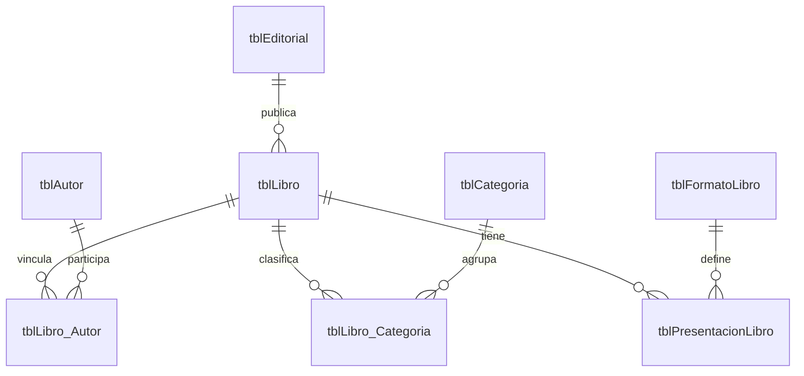

# Catálogo bibliográfico · PlataformaEditorial

Implementación inicial sobre la solución existente, realizada el 11 de noviembre de 2026.
Rama: `feature/catalogo-bibliografico`. El primer commit conserva el estado previo de la solución.

## Arranque y recorrido de prueba

1. Abrir `PlataformaEditorial.slnx` en Visual Studio 2026. Iniciar SQL Server Express y comprobar la conexión `DefaultConnection` a `EditorialDB`.
2. Seleccionar `PlataformaEditorial.Web` como proyecto de inicio y ejecutar el perfil `http` o `https`. Alternativa desde la raíz: `dotnet run --project PlataformaEditorial.Web --launch-profile http`.
3. Abrir `http://localhost:5172/`. Inicio muestra destacados y novedades. Novedades significa los seis últimos libros activos incorporados según `fechaRegistro`, con desempate por `IDLibro`; la base no tiene un indicador de novedad.
4. Abrir `/Catalogo`. Buscar por título, nombre de autor, ISBN o editorial en un único campo. Combinar categoría, precio mínimo, precio máximo y formato. Los filtros están en la URL, por lo que se pueden compartir y conservan su valor al cambiar de página.
5. Pulsar un título para ver `/Catalogo/Detalles/{id}`: sinopsis, año, autores y categorías activos, editorial y cada presentación con formato, ISBN, precio y existencias. Un libro inactivo o inexistente responde 404. Existencias nulas significan «Sin dato», incluso en una presentación digital; no se inventa disponibilidad ilimitada.
6. Iniciar sesión con un usuario que ya tenga el rol `Administrador`. Entrar en `/Administracion`; los enlaces llevan a `/Libros`, `/Autores`, `/Categorias`, `/Editoriales`, `/Formatos` y `/Presentaciones`.
7. Para un libro nuevo, crear primero su editorial y los autores, categorías y formatos necesarios. Crear el libro, seleccionar varias relaciones con Ctrl y guardar. Después crear sus presentaciones. ISBN, precio y existencias se administran en Presentaciones.
8. Marcar `Destacado` en Editar libro y comprobar Inicio. Desactivar un libro y comprobar que desaparece del catálogo. Volver a Editar y marcar `Activo` para reactivarlo.
9. Intentar guardar precio negativo, más de dos decimales, existencias negativas, nombre vacío, nombres demasiado largos, un ISBN duplicado o una combinación libro/formato duplicada. Se muestran errores de validación. El formato de ISBN admite dígitos, X, espacios y guiones; esta versión no verifica su dígito de control.
10. Intentar eliminar una editorial con libros o un formato con presentaciones. Se impide conservar la operación. Visitantes y clientes pueden consultar el catálogo, pero no entrar ni enviar formularios a los mantenimientos.

Se insertaron tres libros ficticios claramente rotulados «demostración», con seis presentaciones, un autor, una editorial, dos categorías y dos formatos de ejemplo. Tienen portada local predeterminada y precios base en quetzales. El script `scripts/datos-demo.sql` solo inserta datos faltantes; se comprobó ejecutándolo dos veces sin duplicados. No modifica datos existentes. Las filas se pueden desactivar desde los mantenimientos correspondientes. Editoriales y formatos relacionados se conservan.

## Archivos y responsabilidades

| Archivos | Responsabilidad |
| --- | --- |
| `Data/ApplicationDbContext.cs`, `Areas/Identity/**`, migraciones previas | Identity existente, sin cambios. Registro, acceso, roles y confirmación de cuenta conservados. |
| `Data/Negocio/EditorialDbContext.cs` | Contexto EF Core del negocio generado desde SQL Server; conserva tablas, columnas, claves, índices únicos, tipos, longitudes y relaciones. No tiene cadena de conexión incrustada. |
| `Models/Entidades/*.cs` | Entidades Database First de las 19 tablas. Hay 17 clases porque las dos tablas puente puras se mapean como relaciones muchos a muchos en el contexto. |
| `Models/Catalogo/CatalogoModelos.cs` | Modelos de entrada y presentación: filtros, tarjetas, opciones y formularios; atributos de validación. No son tablas nuevas. |
| `Models/Servicios/CatalogoService.cs` | Consultas públicas, búsqueda, filtros combinados, paginación de 12, detalles, destacados y novedades. |
| `Models/Servicios/LibrosService.cs` | Guarda libros y sus relaciones; asigna fecha de registro solo al crear y realiza baja lógica. |
| `Models/Servicios/ReferenciasService.cs` | Mantenimientos de autores, categorías, editoriales y formatos, con límites reales de SQL Server. |
| `Models/Servicios/PresentacionesService.cs` | Precio, ISBN, existencias y relaciones de cada presentación; eliminación con comprobación de referencias. |
| `Models/Servicios/ReglaNegocioException.cs` | Errores de negocio y traducción de restricciones SQL a mensajes comprensibles; clase base para guardar. |
| `Controllers/CatalogoController.cs` | GET públicos del catálogo y detalle. Coordina validación del filtro y respuesta HTTP. |
| `Controllers/HomeController.cs` | Solicita al servicio destacados/novedades y entrega el modelo a Inicio. Las acciones previas Privacy/Error se conservan. |
| `Controllers/AdministracionController.cs` | Muestra el panel y mantiene su autorización previa por rol. |
| `Controllers/LibrosController.cs`, `PresentacionesController.cs` | Coordinan formularios, ModelState, servicios, 404, redirecciones y mensajes. No realizan consultas EF. |
| `Controllers/ReferenciasControllerBase.cs`, `AutoresController.cs`, `CategoriasController.cs`, `EditorialesController.cs`, `FormatosController.cs` | Comparten el flujo CRUD para no duplicarlo. Cada controlador concreto fija un tipo permitido y mantiene su propia ruta. La autorización y protección antifalsificación se heredan. |
| `Views/Catalogo/**`, `Views/Home/Index.cshtml`, `Views/Shared/_TarjetasLibros.cshtml` | Presentación pública. Solo muestran el modelo y generan enlaces/formularios; no acceden al contexto. |
| `Views/Administracion/**`, `Views/Libros/**`, `Views/Presentaciones/**`, `Views/Referencias/**` | Panel y formularios administrativos. Referencias comparte vistas; el formulario parcial tiene el mismo modelo plano que recibe el controlador. |
| `Views/Shared/_Layout.cshtml`, `Views/_ViewImports.cshtml` | Navegación al catálogo, enlace administrativo según rol, mensajes y namespaces para Razor. Se conserva `_LoginPartial`. |
| `wwwroot/css/site.css`, `wwwroot/js/site.js`, `wwwroot/images/sin-portada.svg` | Ajustes Bootstrap sencillos, sustitución de portadas que no cargan y portada local predeterminada. |
| `Program.cs` | Registra el contexto y cuatro servicios mediante inyección de dependencias, más `partial Program` para el host de pruebas. Conserva la configuración previa de Identity y la creación de roles. |
| `PlataformaEditorial.Tests/CatalogoIntegracionTests.cs` | Pruebas de servicios y HTTP contra SQL Server real con transacciones revertidas. |
| `scripts/datos-demo.sql`, `scripts/ingenieria-inversa.ps1`, `dotnet-tools.json` | Ejemplos controlados y reproducción de ingeniería inversa con EF 10.0.15. |

## Relaciones reales del catálogo



`tblLibro.IDEditorial` es una clave foránea obligatoria. `tblLibro_Autor` y `tblLibro_Categoria` tienen claves compuestas. EF expone estas relaciones como colecciones `IDAutors` e `IDCategoria`; al guardar, el servicio actualiza ambas colecciones y EF modifica las filas de las tablas puente en la misma operación `SaveChanges`.

`tblPresentacionLibro` contiene `isbn`, `PrecioBase decimal(10,2)`, `Existencias` nullable y las claves `IDLibro`/`IDFormato`. Hay índices únicos para ISBN y para la pareja libro/formato. El precio máximo aceptado es 99,999,999.99, de acuerdo con SQL Server. El libro no tiene precio ni ISBN propios.

Algunas denominaciones C# como `tblCategorium`, `tblAutors` y `tblLibro_Categorium` proceden de la singularización/pluralización automática de EF. Los mapeos `ToTable` apuntan a los nombres SQL originales: no se renombró ninguna tabla ni columna.

Las otras tablas de negocio también tienen entidades, para conservar el modelo completo. No se implementaron sus procesos ni controladores. Sus claves hacia `AspNetUsers` se conservan como propiedades escalares y la restricción sigue existiendo en SQL Server; no se generó otra entidad de usuario ni navegaciones de Identity en el contexto del negocio. EF avisó de esa exclusión durante el scaffold, como corresponde a los dos contextos separados.

## Cómo explicar MVC al docente

Un ejemplo concreto: al enviar `/Catalogo?Texto=arquitectura&FormatoId=2&PrecioMaximo=90`, el enrutamiento llama a `CatalogoController.Index`. MVC construye y valida `FiltroCatalogo` a partir de la URL. El controlador pide a `CatalogoService` la búsqueda. El servicio compone consultas LINQ, que EF traduce a SQL parametrizado sobre `EditorialDbContext`, y prepara `CatalogoPagina`. La vista Razor recibe ese modelo y muestra filtros y tarjetas.

El **Modelo** incluye las entidades, el contexto, los modelos de entrada/salida y los servicios con reglas y consultas. El **Controlador** coordina HTTP y el flujo de una solicitud. La **Vista** muestra información, mensajes y formularios. Un servicio puede utilizar EF sin que la vista o el controlador conozcan los detalles de SQL.

Para editar, el GET pide el formulario y sus listas al servicio. El POST comprueba autorización, token antifalsificación, identificador y `ModelState`; si hay errores vuelve a la vista con sus listas. Si todo es válido, el servicio carga la entidad persistida, aplica solo los campos permitidos y guarda. El controlador redirige al índice para evitar repetir la operación al recargar. Se usan modelos de entrada específicos y listas de propiedades permitidas para no enlazar directamente un grafo de entidades enviado por el cliente.

El buscador filtra únicamente libros activos. Los autores y categorías inactivos se conservan en administración y en las relaciones, pero se excluyen de las consultas públicas. Los filtros por precio y formato deben cumplirse en la misma presentación. Las tarjetas muestran el precio mínimo y los formatos de las presentaciones que cumplen el filtro; la página de detalles muestra todas las presentaciones del libro.

Las consultas públicas usan `AsNoTracking` y `AsSplitQuery` para cargar las colecciones necesarias sin seguimiento de escritura ni multiplicar filas de varias relaciones. El precio se muestra como precio base; no se calculan impuestos ni descuentos.

## Política de eliminación y seguridad

- Libros, autores y categorías: `Activo=false`; las filas y relaciones se conservan. Se reactivan en Editar.
- Editoriales y formatos: la tabla no tiene `Activo`. Se eliminan físicamente únicamente si no hay referencias; no se agregaron columnas para inventar eliminación lógica.
- Presentaciones: sin `Activo`; se eliminan únicamente cuando no están referenciadas por detalles de carrito/pedido. Los datos relacionados no se eliminan en cascada.
- La confirmación GET solo presenta el registro. La modificación sucede en POST protegido por autorización y token antifalsificación. Los índices y claves de SQL Server respaldan las comprobaciones del servicio.
- El enlace administrativo oculto es una comodidad visual; la seguridad efectiva está en `[Authorize(Roles="Administrador")]` de los controladores. Los cuatro roles previos no cambiaron.
- No se añadieron migraciones, no se ejecutaron `database update`, `EnsureCreated` ni `EnsureDeleted`, y no se recreó Identity. La base mantiene sus 19 tablas del negocio y 7 de Identity.

## Compilación y pruebas automatizadas

Desde la raíz:

```powershell
dotnet tool restore
dotnet restore PlataformaEditorial.slnx
dotnet build PlataformaEditorial.slnx --no-restore
dotnet test PlataformaEditorial.slnx --no-restore
```

Las pruebas necesitan acceso Windows a `.\SQLEXPRESS/EditorialDB`. Se puede configurar `EDITORIAL_TEST_CONNECTION` para una copia compatible de la base. No se crean tablas. Los datos temporales viven dentro de transacciones que se revierten incluso si falla una aserción; los contadores identity pueden avanzar por el comportamiento normal de SQL Server.

Se verificaron dos escenarios de integración que contienen múltiples comprobaciones: CRUD, relaciones, búsquedas en los cuatro campos, filtros por la misma presentación, destacados/novedades, desactivación/reactivación, restricciones de eliminación y duplicados; y rutas públicas/administrativas, rol ClienteMinorista, formularios Razor, tokens antifalsificación, validación, creación/edición/baja de autor, creación/baja de libro y presentación, y detalle con datos. La autenticación artificial se registra únicamente en el host de pruebas; no cambia la autenticación de la aplicación. También se comprobó en el servidor normal que un anónimo recibe una redirección al Login existente.

No se creó ni promovió ningún usuario. Para probar administración se usa una cuenta existente con el rol correspondiente. Carrito, descuentos, pedidos y cotizaciones permanecen fuera de este trabajo. En la carpeta inspeccionada no había un `CotizacionesController`; no se creó uno nuevo.

## Ingeniería inversa y mantenimiento futuro

La ingeniería inversa se ejecutó con `dotnet ef dbcontext scaffold` y selección explícita de las 19 tablas `tbl*`. Las entidades y su contexto se mantienen separados del código de servicios para poder regenerarlos y revisar las diferencias cuando cambie deliberadamente el esquema.

`scripts/ingenieria-inversa.ps1` registra el comando reproducible sin `--force`: si los archivos existen, EF se detiene para evitar sobrescribirlos. Para una regeneración futura, trabajar sobre otra rama o una salida temporal y comparar. No usar migraciones del contexto del negocio sobre estas tablas. El script no incluye tablas `AspNet*` ni genera configuración con credenciales.
