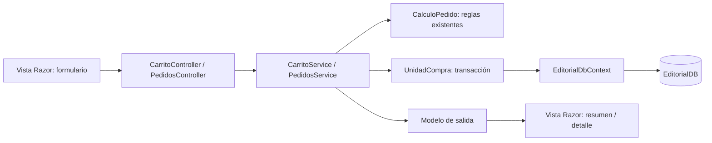

# Revisión final de la entrega académica

Fecha: 13/11/2026. Rama obligatoria: `feature/carrito-pedidos`. Base de trabajo: commit `e8344b1`, que incluía los avances de interfaz y `CalculoPedido.cs` del usuario. No se trabajó sobre `main` ni se eliminaron ramas.

## Recuperación después del reinicio

Se volvió a consultar el estado de Git, los archivos generados y los procesos. La última operación antes de perder la sesión había quedado parcialmente ejecutada: existía el proyecto de herramientas, pero faltaban su referencia y su inclusión en la solución; el script de estructura aún no se había generado. Se corrigió el exportador de metadatos, se generó el esquema y se completó el proyecto. Después se compiló y se ejecutaron las pruebas. No se asumió que los comandos interrumpidos hubieran terminado.

El corte posterior de control de computadora fue distinto: la herramienta no pudo identificar la URL de Opera y exigió terminar aquel turno. En ese momento el código y las 39 pruebas estaban completos, pero faltaban README, esta revisión, commits/publicación y revisión visual. Se retomaron expresamente esos pendientes en el siguiente turno. El bloqueo visual no se presenta como una prueba superada.

## RF-03 y reglas de compra

- El carrito y sus detalles se guardan en `tblCarrito` y `tblDetalleCarrito`. El propietario se obtiene de Identity, no de un campo enviado por el navegador.
- Agregar acumula la cantidad de una presentación sin duplicar la pareja carrito/presentación. Cambiar, quitar y vaciar verifican el carrito propio.
- Las operaciones de compra exigen un rol de cliente. El administrador puede consultar todos los pedidos y gestionar estados; un asesor sin rol de cliente no puede comprar ni consultar pedidos privados.
- Los descuentos se calculan por unidades totales: 1–5: 0 %; 6–20: 5 %; 21–50: 10 %; desde 51: 15 %. Se reutilizó sin modificar `CalculoPedido.cs`.
- El descuento institucional del 8 % se aplica sobre la base posterior al volumen y requiere simultáneamente rol institucional y perfil aprobado. Después se aplica el IVA configurado; no se asume una tasa si falta la configuración.
- Ejemplos comprobados: subtotal Q305, 15 unidades e IVA 12 % dan Q324.52 para minorista y Q298.56 para institución aprobada.
- Se rechazan cantidades fuera de 1 a 100000 por línea, carritos vacíos, libros inactivos, existencias impresas insuficientes y totales fuera de los tipos monetarios reales.
- Un físico con existencias nulas se considera no disponible. Una presentación con `EsDigital=true` no necesita ni consume inventario físico; no requiere dirección si todo el pedido es digital.
- Confirmar vuelve a consultar los precios y el impuesto. Un token protegido, con vencimiento de 30 minutos, vincula la confirmación al usuario, las líneas/IDs/cantidades, los precios y las condiciones de descuento/IVA. Los campos adicionales de precio o total del navegador no son autoritativos.
- Una transacción serializable bloquea el carrito y las presentaciones en orden con `UPDLOCK,HOLDLOCK`, registra el pedido/detalles, descuenta stock físico y elimina las líneas compradas. Si falla, no se confirma parcialmente la compra.
- Tras confirmar, el carrito queda vacío; un reenvío del formulario no genera un segundo pedido. Si el usuario agrega de nuevo el mismo producto, los IDs nuevos de las líneas hacen inválida la confirmación anterior.
- Se guardan precios, cantidades, descuentos y porcentaje/importe fiscal en las columnas existentes de `tblPedido` y `tblDetallePedido`.
- Estados impresos: Pendiente → EnProceso → Enviado → Entregado. Solo digitales: Pendiente → EnProceso → Entregado. El administrador no puede saltar a un estado arbitrario y los clientes no pueden cambiar estados.

No hay pasarela de pago, cancelaciones, devoluciones, descarga de obras ni creación de pedidos desde cotizaciones. No se simulan esos procesos. Se registra un pedido de compra pendiente y la entrega digital queda a cargo de la editorial. Esas limitaciones se muestran/documentan y no se presentan como módulos terminados.

## MVC y relación entre componentes

Los controladores manejan HTTP y coordinan. El Modelo contiene entidades, modelos de entrada/salida y servicios con reglas y consultas. Las vistas muestran información y formularios; no leen el contexto ni calculan descuentos. El menú usa un ViewComponent que consulta el estado del perfil y entrega un modelo a su vista.

`ApplicationDbContext`, `IdentityUser`, `EditorialDbContext` y los modelos generados se conservaron. La fábrica nueva solo sirve a las herramientas de diseño de EF. Los servicios y controladores del catálogo y RF-04 no se modificaron. RF-04 sigue usando su cálculo y flujo de aprobación previo.

## Traducción, correo y navegación

Se tradujeron las páginas de cuenta, confirmaciones, contraseñas, dos factores, datos personales y accesos externos, además de etiquetas, mensajes y errores de Identity. `ErroresIdentityEspanol` conserva los códigos técnicos pero proporciona descripciones en español. Un proveedor de metadatos traduce las validaciones automáticas, y se configuraron mensajes de model binding y jQuery Validation. Los errores generales y 404 se presentan en español. Los comentarios técnicos, identificadores y logs internos no son textos de interfaz y no se renombraron.

Se mantiene la confirmación de cuenta obligatoria. Sin un correo real configurado, registro deja la cuenta pendiente y explica cómo habilitarla localmente; no publica tokens de confirmación. Recuperación, reenvío y cambio de correo no anuncian envíos inexistentes. La herramienta local emplea `UserManager` para crear/confirmar cuentas y nunca admite conceder `ClienteInstitucional`; ese rol sigue dependiendo de la aprobación de RF-04.

El menú permite encontrar catálogo, carrito, pedidos y solicitudes institucionales según rol. Si el perfil ya existe, muestra su estado. Asesores encuentran su bandeja y administradores los mantenimientos, validación de perfiles, solicitudes y pedidos. El registro público no recibe un selector de roles.

## Libros y base de datos

Se ejecutó `scripts/libros-reales.sql` dos veces. Se verificaron 20 títulos impresos y tres ISBN digitales adicionales, sin duplicarlos al repetir. Las fichas editoriales y fechas están en `FUENTES-LIBROS.csv`; los ISBN impresos tienen dígito de control válido y correspondencia bibliográfica verificada. Los precios se identifican como académicos y los inventarios iniciales son de prueba. El script no modifica precios ni repone stock de presentaciones existentes.

La base conservaba los tres libros ficticios iniciales, aunque el usuario había indicado que ya los había eliminado. Se conservaron: el total después de la carga es 23 libros y 29 presentaciones. No se borraron usuarios, pedidos, cotizaciones ni datos previos para obtener un catálogo aparentemente limpio.

Se preparó `estructura-negocio.sql` a partir de metadatos: 19 tablas y 21 claves foráneas de negocio, incluidos sus enlaces a Identity. Solo crea objetos faltantes y no elimina ni altera columnas. Se comprobó sintaxis con `PARSEONLY`; no se aplicó sobre la base real ni se ensayó la instalación en una segunda instancia. El README separa las instrucciones para una instalación nueva de las de un entorno existente. No se ejecutaron migraciones en la base real.

Se conservó la portada predeterminada. No se copiaron imágenes editoriales sin autorización; `PORTADAS-Y-FUENTES.md` explica cómo colocar las portadas correctas manualmente.

## Pruebas y alcance de la evidencia

Resultado verificado: **39 pruebas aprobadas**, compilación de la solución con **0 errores y 0 advertencias**. Además se comprobó `dotnet ef dbcontext info` con la fábrica nueva y la ayuda de la herramienta local de usuarios.

- 25 pruebas anteriores: catálogo, RF-04, seguridad institucional, estados, cálculos y PDF.
- 12 casos de compras: límites de 5/6/20/21/50/51 unidades, ejemplos minorista/institucional, carrito persistente, pedido y stock físico/digital, historial, propiedad, cantidades, precios cambiados, falta de stock, reenvío, estados y antifalsificación.
- 2 pruebas de localización/navegación: mensajes automáticos en español, confirmación sin tokens expuestos, correo no simulado, 404, estado del perfil y páginas de cuenta.

Las pruebas de SQL utilizan transacciones revertidas, con usuarios y datos temporales. Se ejecutan en serie para no interferir entre escenarios. El bloqueo concurrente se basa en la transacción y los hints SQL; la suite prueba reenvíos y falta de stock, pero no constituye una prueba de carga de múltiples procesos simultáneos. Los IDs pueden avanzar por las inserciones revertidas.

No se creó una cuenta real de demostración automáticamente ni se introdujo ninguna contraseña personal. La creación interactiva se documenta para que el usuario elija las cuentas. No se modificó la configuración de autenticación para eludir la confirmación.

## Rutas y recorrido

| Ruta | Uso |
| --- | --- |
| `/` y `/Catalogo` | Inicio, destacados, novedades, búsqueda y filtros. |
| `/Catalogo/Detalles/{id}` | Elegir presentación/cantidad y agregar al carrito. |
| `/Carrito` | Cambiar cantidades, quitar/vaciar, revisar descuentos/IVA y confirmar. |
| `/Pedidos` | Historial propio o supervisión administrativa. |
| `/Pedidos/Detalles/{id}` | Detalle autorizado y siguiente estado permitido al administrador. |
| `/PerfilInstitucional` | Ver estado del perfil o acceder a la solicitud. |
| `/PerfilesInstitucionales` | Validación administrativa. |
| `/SolicitudesInstitucionales` | Solicitudes propias/asignadas o supervisión. |
| `/CotizacionesInstitucionales/Documento/{id}` y `/Pdf/{id}` | Cotización formal y PDF autorizado. |
| `/Identity/Account/Manage` | Gestión de cuenta en español. |

Para demostrar: crear/confirmar un minorista mediante Identity, comprar dos presentaciones, comprobar carrito vacío y pedido/stock, revisar como otra cuenta, avanzar estados como administrador y repetir con una institución aprobada. El README detalla los comandos y el recorrido completo de RF-04.

## Inventario de esta entrega

La siguiente lista corresponde a archivos creados o modificados respecto al estado de partida; los archivos generados del negocio y `CalculoPedido.cs` no fueron reescritos.

| Archivo | Cambio | Responsabilidad |
| --- | --- | --- |
| `.gitignore` | Modificado | Excluye resultados temporales de pruebas, además de secretos y binarios ya excluidos. |
| `PlataformaEditorial.Tests/ComprasTests.cs` | Creado | Pruebas automatizadas de compra, descuentos, inventario, seguridad o localización; ejecución en serie con datos SQL revertidos. |
| `PlataformaEditorial.Tests/ConfiguracionPruebas.cs` | Creado | Pruebas automatizadas de compra, descuentos, inventario, seguridad o localización; ejecución en serie con datos SQL revertidos. |
| `PlataformaEditorial.Tests/LocalizacionTests.cs` | Creado | Pruebas automatizadas de compra, descuentos, inventario, seguridad o localización; ejecución en serie con datos SQL revertidos. |
| `PlataformaEditorial.Web/Areas/Identity/Pages/Account/ConfirmEmail.cshtml.cs` | Modificado | Traducción de etiquetas, validaciones, estados o mensajes de la cuenta; conserva el flujo de Identity. |
| `PlataformaEditorial.Web/Areas/Identity/Pages/Account/ConfirmEmailChange.cshtml.cs` | Modificado | Traducción de etiquetas, validaciones, estados o mensajes de la cuenta; conserva el flujo de Identity. |
| `PlataformaEditorial.Web/Areas/Identity/Pages/Account/ExternalLogin.cshtml` | Modificado | Traducción de etiquetas, validaciones, estados o mensajes de la cuenta; conserva el flujo de Identity. |
| `PlataformaEditorial.Web/Areas/Identity/Pages/Account/ExternalLogin.cshtml.cs` | Modificado | Traducción de etiquetas, validaciones, estados o mensajes de la cuenta; conserva el flujo de Identity. |
| `PlataformaEditorial.Web/Areas/Identity/Pages/Account/ForgotPassword.cshtml` | Modificado | Traducción de la interfaz y mensajes; los handlers de correo/confirmación también evitan anuncios de envío inexistente y tokens públicos. |
| `PlataformaEditorial.Web/Areas/Identity/Pages/Account/ForgotPassword.cshtml.cs` | Modificado | Traducción de la interfaz y mensajes; los handlers de correo/confirmación también evitan anuncios de envío inexistente y tokens públicos. |
| `PlataformaEditorial.Web/Areas/Identity/Pages/Account/ForgotPasswordConfirmation.cshtml` | Modificado | Traducción de la interfaz y mensajes; los handlers de correo/confirmación también evitan anuncios de envío inexistente y tokens públicos. |
| `PlataformaEditorial.Web/Areas/Identity/Pages/Account/Login.cshtml` | Modificado | Traducción de etiquetas, validaciones, estados o mensajes de la cuenta; conserva el flujo de Identity. |
| `PlataformaEditorial.Web/Areas/Identity/Pages/Account/Login.cshtml.cs` | Modificado | Traducción de etiquetas, validaciones, estados o mensajes de la cuenta; conserva el flujo de Identity. |
| `PlataformaEditorial.Web/Areas/Identity/Pages/Account/LoginWith2fa.cshtml` | Modificado | Traducción de etiquetas, validaciones, estados o mensajes de la cuenta; conserva el flujo de Identity. |
| `PlataformaEditorial.Web/Areas/Identity/Pages/Account/LoginWith2fa.cshtml.cs` | Modificado | Traducción de etiquetas, validaciones, estados o mensajes de la cuenta; conserva el flujo de Identity. |
| `PlataformaEditorial.Web/Areas/Identity/Pages/Account/LoginWithRecoveryCode.cshtml.cs` | Modificado | Traducción de etiquetas, validaciones, estados o mensajes de la cuenta; conserva el flujo de Identity. |
| `PlataformaEditorial.Web/Areas/Identity/Pages/Account/Manage/ChangePassword.cshtml` | Modificado | Traducción de etiquetas, validaciones, estados o mensajes de la cuenta; conserva el flujo de Identity. |
| `PlataformaEditorial.Web/Areas/Identity/Pages/Account/Manage/ChangePassword.cshtml.cs` | Modificado | Traducción de etiquetas, validaciones, estados o mensajes de la cuenta; conserva el flujo de Identity. |
| `PlataformaEditorial.Web/Areas/Identity/Pages/Account/Manage/DeletePersonalData.cshtml` | Modificado | Traducción de etiquetas, validaciones, estados o mensajes de la cuenta; conserva el flujo de Identity. |
| `PlataformaEditorial.Web/Areas/Identity/Pages/Account/Manage/DeletePersonalData.cshtml.cs` | Modificado | Traducción de etiquetas, validaciones, estados o mensajes de la cuenta; conserva el flujo de Identity. |
| `PlataformaEditorial.Web/Areas/Identity/Pages/Account/Manage/Disable2fa.cshtml` | Modificado | Traducción de etiquetas, validaciones, estados o mensajes de la cuenta; conserva el flujo de Identity. |
| `PlataformaEditorial.Web/Areas/Identity/Pages/Account/Manage/Disable2fa.cshtml.cs` | Modificado | Traducción de etiquetas, validaciones, estados o mensajes de la cuenta; conserva el flujo de Identity. |
| `PlataformaEditorial.Web/Areas/Identity/Pages/Account/Manage/DownloadPersonalData.cshtml` | Modificado | Traducción de etiquetas, validaciones, estados o mensajes de la cuenta; conserva el flujo de Identity. |
| `PlataformaEditorial.Web/Areas/Identity/Pages/Account/Manage/DownloadPersonalData.cshtml.cs` | Modificado | Traducción de etiquetas, validaciones, estados o mensajes de la cuenta; conserva el flujo de Identity. |
| `PlataformaEditorial.Web/Areas/Identity/Pages/Account/Manage/Email.cshtml` | Modificado | Traducción de la interfaz y mensajes; los handlers de correo/confirmación también evitan anuncios de envío inexistente y tokens públicos. |
| `PlataformaEditorial.Web/Areas/Identity/Pages/Account/Manage/Email.cshtml.cs` | Modificado | Traducción de la interfaz y mensajes; los handlers de correo/confirmación también evitan anuncios de envío inexistente y tokens públicos. |
| `PlataformaEditorial.Web/Areas/Identity/Pages/Account/Manage/EnableAuthenticator.cshtml` | Modificado | Traducción de etiquetas, validaciones, estados o mensajes de la cuenta; conserva el flujo de Identity. |
| `PlataformaEditorial.Web/Areas/Identity/Pages/Account/Manage/EnableAuthenticator.cshtml.cs` | Modificado | Traducción de etiquetas, validaciones, estados o mensajes de la cuenta; conserva el flujo de Identity. |
| `PlataformaEditorial.Web/Areas/Identity/Pages/Account/Manage/ExternalLogins.cshtml` | Modificado | Traducción de etiquetas, validaciones, estados o mensajes de la cuenta; conserva el flujo de Identity. |
| `PlataformaEditorial.Web/Areas/Identity/Pages/Account/Manage/ExternalLogins.cshtml.cs` | Modificado | Traducción de etiquetas, validaciones, estados o mensajes de la cuenta; conserva el flujo de Identity. |
| `PlataformaEditorial.Web/Areas/Identity/Pages/Account/Manage/GenerateRecoveryCodes.cshtml` | Modificado | Traducción de etiquetas, validaciones, estados o mensajes de la cuenta; conserva el flujo de Identity. |
| `PlataformaEditorial.Web/Areas/Identity/Pages/Account/Manage/GenerateRecoveryCodes.cshtml.cs` | Modificado | Traducción de etiquetas, validaciones, estados o mensajes de la cuenta; conserva el flujo de Identity. |
| `PlataformaEditorial.Web/Areas/Identity/Pages/Account/Manage/Index.cshtml` | Modificado | Traducción de etiquetas, validaciones, estados o mensajes de la cuenta; conserva el flujo de Identity. |
| `PlataformaEditorial.Web/Areas/Identity/Pages/Account/Manage/Index.cshtml.cs` | Modificado | Traducción de etiquetas, validaciones, estados o mensajes de la cuenta; conserva el flujo de Identity. |
| `PlataformaEditorial.Web/Areas/Identity/Pages/Account/Manage/PersonalData.cshtml` | Modificado | Traducción de etiquetas, validaciones, estados o mensajes de la cuenta; conserva el flujo de Identity. |
| `PlataformaEditorial.Web/Areas/Identity/Pages/Account/Manage/PersonalData.cshtml.cs` | Modificado | Traducción de etiquetas, validaciones, estados o mensajes de la cuenta; conserva el flujo de Identity. |
| `PlataformaEditorial.Web/Areas/Identity/Pages/Account/Manage/ResetAuthenticator.cshtml` | Modificado | Traducción de etiquetas, validaciones, estados o mensajes de la cuenta; conserva el flujo de Identity. |
| `PlataformaEditorial.Web/Areas/Identity/Pages/Account/Manage/ResetAuthenticator.cshtml.cs` | Modificado | Traducción de etiquetas, validaciones, estados o mensajes de la cuenta; conserva el flujo de Identity. |
| `PlataformaEditorial.Web/Areas/Identity/Pages/Account/Manage/SetPassword.cshtml` | Modificado | Traducción de etiquetas, validaciones, estados o mensajes de la cuenta; conserva el flujo de Identity. |
| `PlataformaEditorial.Web/Areas/Identity/Pages/Account/Manage/SetPassword.cshtml.cs` | Modificado | Traducción de etiquetas, validaciones, estados o mensajes de la cuenta; conserva el flujo de Identity. |
| `PlataformaEditorial.Web/Areas/Identity/Pages/Account/Manage/ShowRecoveryCodes.cshtml` | Modificado | Traducción de etiquetas, validaciones, estados o mensajes de la cuenta; conserva el flujo de Identity. |
| `PlataformaEditorial.Web/Areas/Identity/Pages/Account/Manage/TwoFactorAuthentication.cshtml` | Modificado | Traducción de etiquetas, validaciones, estados o mensajes de la cuenta; conserva el flujo de Identity. |
| `PlataformaEditorial.Web/Areas/Identity/Pages/Account/Manage/TwoFactorAuthentication.cshtml.cs` | Modificado | Traducción de etiquetas, validaciones, estados o mensajes de la cuenta; conserva el flujo de Identity. |
| `PlataformaEditorial.Web/Areas/Identity/Pages/Account/Manage/_Layout.cshtml` | Modificado | Traducción de etiquetas, validaciones, estados o mensajes de la cuenta; conserva el flujo de Identity. |
| `PlataformaEditorial.Web/Areas/Identity/Pages/Account/Manage/_ManageNav.cshtml` | Modificado | Traducción de etiquetas, validaciones, estados o mensajes de la cuenta; conserva el flujo de Identity. |
| `PlataformaEditorial.Web/Areas/Identity/Pages/Account/Manage/_StatusMessage.cshtml` | Modificado | Traducción de etiquetas, validaciones, estados o mensajes de la cuenta; conserva el flujo de Identity. |
| `PlataformaEditorial.Web/Areas/Identity/Pages/Account/Register.cshtml` | Modificado | Traducción de la interfaz y mensajes; los handlers de correo/confirmación también evitan anuncios de envío inexistente y tokens públicos. |
| `PlataformaEditorial.Web/Areas/Identity/Pages/Account/Register.cshtml.cs` | Modificado | Traducción de la interfaz y mensajes; los handlers de correo/confirmación también evitan anuncios de envío inexistente y tokens públicos. |
| `PlataformaEditorial.Web/Areas/Identity/Pages/Account/RegisterConfirmation.cshtml` | Modificado | Traducción de la interfaz y mensajes; los handlers de correo/confirmación también evitan anuncios de envío inexistente y tokens públicos. |
| `PlataformaEditorial.Web/Areas/Identity/Pages/Account/RegisterConfirmation.cshtml.cs` | Modificado | Traducción de la interfaz y mensajes; los handlers de correo/confirmación también evitan anuncios de envío inexistente y tokens públicos. |
| `PlataformaEditorial.Web/Areas/Identity/Pages/Account/ResendEmailConfirmation.cshtml` | Modificado | Traducción de la interfaz y mensajes; los handlers de correo/confirmación también evitan anuncios de envío inexistente y tokens públicos. |
| `PlataformaEditorial.Web/Areas/Identity/Pages/Account/ResendEmailConfirmation.cshtml.cs` | Modificado | Traducción de la interfaz y mensajes; los handlers de correo/confirmación también evitan anuncios de envío inexistente y tokens públicos. |
| `PlataformaEditorial.Web/Areas/Identity/Pages/Account/ResetPassword.cshtml` | Modificado | Traducción de etiquetas, validaciones, estados o mensajes de la cuenta; conserva el flujo de Identity. |
| `PlataformaEditorial.Web/Areas/Identity/Pages/Account/ResetPassword.cshtml.cs` | Modificado | Traducción de etiquetas, validaciones, estados o mensajes de la cuenta; conserva el flujo de Identity. |
| `PlataformaEditorial.Web/Areas/Identity/Pages/Account/_StatusMessage.cshtml` | Modificado | Traducción de etiquetas, validaciones, estados o mensajes de la cuenta; conserva el flujo de Identity. |
| `PlataformaEditorial.Web/Areas/Identity/Pages/Error.cshtml` | Modificado | Traducción de etiquetas, validaciones, estados o mensajes de la cuenta; conserva el flujo de Identity. |
| `PlataformaEditorial.Web/Areas/Identity/Pages/_ViewStart.cshtml` | Modificado | Traducción de etiquetas, validaciones, estados o mensajes de la cuenta; conserva el flujo de Identity. |
| `PlataformaEditorial.Web/Controllers/Compras/CarritoController.cs` | Creado | Coordinación MVC, validación, autorización, antifalsificación y errores del flujo de compra. |
| `PlataformaEditorial.Web/Controllers/Compras/FiltroCompraAttribute.cs` | Creado | Coordinación MVC, validación, autorización, antifalsificación y errores del flujo de compra. |
| `PlataformaEditorial.Web/Controllers/Compras/PedidosController.cs` | Creado | Coordinación MVC, validación, autorización, antifalsificación y errores del flujo de compra. |
| `PlataformaEditorial.Web/Controllers/ErroresController.cs` | Creado | Errores generales y códigos HTTP presentados en español sin detalles técnicos sensibles. |
| `PlataformaEditorial.Web/Data/ApplicationDbContextFactory.cs` | Creado | Fábrica de diseño para ejecutar comandos EF de Identity sin activar previamente el inicializador de roles. |
| `PlataformaEditorial.Web/Localizacion/CorreoNoConfigurado.cs` | Creado | Mensajes de validación e Identity en español o rechazo explícito de envíos de correo no configurados. |
| `PlataformaEditorial.Web/Localizacion/ErroresIdentityEspanol.cs` | Creado | Mensajes de validación e Identity en español o rechazo explícito de envíos de correo no configurados. |
| `PlataformaEditorial.Web/Localizacion/ValidacionEspanol.cs` | Creado | Mensajes de validación e Identity en español o rechazo explícito de envíos de correo no configurados. |
| `PlataformaEditorial.Web/Models/Compras/ModelosCompra.cs` | Creado | Entradas y modelos de salida del carrito y pedido; actor obtenido del usuario autenticado. |
| `PlataformaEditorial.Web/Models/Servicios/Compras/CarritoService.cs` | Creado | Reglas y transacciones del carrito/pedido; control de disponibilidad, propiedad y estados, reutilizando CalculoPedido. |
| `PlataformaEditorial.Web/Models/Servicios/Compras/PedidosService.cs` | Creado | Reglas y transacciones del carrito/pedido; control de disponibilidad, propiedad y estados, reutilizando CalculoPedido. |
| `PlataformaEditorial.Web/Models/Servicios/Compras/UnidadCompra.cs` | Creado | Reglas y transacciones del carrito/pedido; control de disponibilidad, propiedad y estados, reutilizando CalculoPedido. |
| `PlataformaEditorial.Web/Program.cs` | Modificado | Registro de servicios de compras, localización es-GT, errores de Identity y páginas de error en español; no ejecuta migraciones. |
| `PlataformaEditorial.Web/ViewComponents/MenuInstitucionalViewComponent.cs` | Creado | Navegación preparada desde el servidor según roles y estado real del perfil institucional. |
| `PlataformaEditorial.Web/Views/Carrito/Index.cshtml` | Creado | Presentación Razor del carrito, confirmación, historial, detalle o errores; sin consultas directas a SQL. |
| `PlataformaEditorial.Web/Views/Catalogo/Detalles.cshtml` | Modificado | Formularios de agregar al carrito y avisos de precio/inventario académico; consultas y servicios del catálogo intactos. |
| `PlataformaEditorial.Web/Views/Catalogo/Index.cshtml` | Modificado | Formularios de agregar al carrito y avisos de precio/inventario académico; consultas y servicios del catálogo intactos. |
| `PlataformaEditorial.Web/Views/Compras/Error.cshtml` | Creado | Presentación Razor del carrito, confirmación, historial, detalle o errores; sin consultas directas a SQL. |
| `PlataformaEditorial.Web/Views/Errores/Estado.cshtml` | Creado | Errores generales y códigos HTTP presentados en español sin detalles técnicos sensibles. |
| `PlataformaEditorial.Web/Views/Home/Privacy.cshtml` | Modificado | Página Acerca de con descripción del propósito académico. |
| `PlataformaEditorial.Web/Views/Pedidos/Detalles.cshtml` | Creado | Presentación Razor del carrito, confirmación, historial, detalle o errores; sin consultas directas a SQL. |
| `PlataformaEditorial.Web/Views/Pedidos/Index.cshtml` | Creado | Presentación Razor del carrito, confirmación, historial, detalle o errores; sin consultas directas a SQL. |
| `PlataformaEditorial.Web/Views/Referencias/Index.cshtml` | Modificado | Etiqueta Categorías con acento en administración. |
| `PlataformaEditorial.Web/Views/Shared/Components/MenuInstitucional/Default.cshtml` | Creado | Navegación preparada desde el servidor según roles y estado real del perfil institucional. |
| `PlataformaEditorial.Web/Views/Shared/Error.cshtml` | Modificado | Errores generales y códigos HTTP presentados en español sin detalles técnicos sensibles. |
| `PlataformaEditorial.Web/Views/Shared/_Layout.cshtml` | Modificado | Menú Bootstrap por rol, carrito, pedidos, instituciones y administración; ajuste responsive. |
| `PlataformaEditorial.Web/Views/Shared/_LoginPartial.cshtml` | Modificado | Textos de cuenta y cierre de sesión en español. |
| `PlataformaEditorial.Web/Views/Shared/_TarjetasLibros.cshtml` | Modificado | Identificación visible del precio académico antes de IVA. |
| `PlataformaEditorial.Web/Views/Shared/_ValidationScriptsPartial.cshtml` | Modificado | Carga y mensajes de validación del navegador en español. |
| `PlataformaEditorial.Web/wwwroot/js/validacion-es.js` | Creado | Carga y mensajes de validación del navegador en español. |
| `PlataformaEditorial.slnx` | Modificado | Incluye la herramienta local opcional sin reemplazar los proyectos existentes. |
| `README.md` | Creado | Instalación, arquitectura MVC, correo, cuentas de prueba, cálculos y demostración. |
| `docs/FUENTES-LIBROS.csv` | Creado | Documentación de revisión, fuentes verificadas o portadas autorizadas. |
| `docs/PORTADAS-Y-FUENTES.md` | Creado | Documentación de revisión, fuentes verificadas o portadas autorizadas. |
| `docs/REVISION-FINAL.md` | Creado | Documentación de revisión, fuentes verificadas o portadas autorizadas. |
| `scripts/estructura-negocio.sql` | Creado | DDL no destructivo de las 19 tablas reales para otra computadora; requiere Identity previamente instalado. |
| `scripts/libros-reales.sql` | Creado | Carga reproducible de 20 títulos y 23 ISBN; solo inserta faltantes y no repone inventario al repetir. |
| `tools/PlataformaEditorial.Herramientas/PlataformaEditorial.Herramientas.csproj` | Creado | Herramienta local de Identity para crear cuentas de demostración o confirmar cuentas, sin publicar contraseñas ni asignar el rol institucional. |
| `tools/PlataformaEditorial.Herramientas/Program.cs` | Creado | Herramienta local de Identity para crear cuentas de demostración o confirmar cuentas, sin publicar contraseñas ni asignar el rol institucional. |

## Dependencias y pendientes explícitos

No se añadió una dependencia de compras: Data Protection, MVC e Identity pertenecen a la plataforma ya utilizada. La herramienta local referencia el proyecto existente. QuestPDF ya era dependencia de RF-04. SQL Server Express y los paquetes de NuGet existentes siguen siendo necesarios.

Los únicos puntos fuera de la verificación automatizada son la instalación completa en otra computadora, el proveedor real de correo, el cobro electrónico, la distribución autorizada de archivos digitales y una prueba de carga concurrente. La revisión visual y la publicación Git se informan según el resultado real del cierre, sin asumirlas por tener el código compilado. La publicación, si se consigue, se hace únicamente en `feature/carrito-pedidos`, sin merge a `main`.

## Cierre verificado después de la recuperación

Se repitieron la compilación completa y las 39 pruebas después de retomar el trabajo. Resultado: 0 errores, 0 advertencias y todas las pruebas aprobadas. Se comprobó que `CalculoPedido.cs`, las entidades generadas y los servicios/controladores de RF-04 no cambiaron. La base conserva las 19 tablas de negocio y las 7 de Identity, 23 libros y 29 presentaciones, con IVA 12 %.

La revisión visual se reintentó satisfactoriamente mediante el navegador integrado. Se comprobaron Inicio, menú público desplegable, catálogo, búsqueda de Fahrenheit con un resultado, detalle con ISBN/stock y acceso a compras, formulario de inicio de sesión, validaciones obligatorias y página 404 en español. Se encontraron caracteres de BOM mal decodificados en dos parciales; se corrigieron y se añadieron aserciones de regresión. Los flujos autenticados se comprobaron mediante las pruebas HTTP/SQL, sin iniciar sesión con contraseñas personales durante esta revisión.

El código, README, inventario y scripts se guardaron en commits descriptivos y se publicaron en `origin/feature/carrito-pedidos`. No se hizo merge a `main` ni se eliminaron ramas. El reinicio y el bloqueo posterior del navegador no se dieron por superados por suposición: se retomó desde el estado real de archivos/Git y se repitieron las verificaciones.
