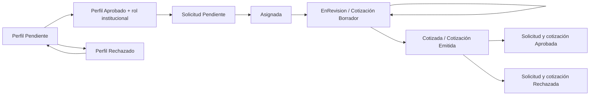

# RF-04 · Solicitudes y cotizaciones institucionales

Implementado el 12 de noviembre de 2026 sobre la solución existente. Rama `feature/cotizaciones-institucionales`, creada desde el catálogo funcional. No se generaron entidades nuevas ni migraciones.

## Ejecución y rutas

Abrir `PlataformaEditorial.slnx`, seleccionar `PlataformaEditorial.Web` y ejecutar el perfil `http` o `https`. Alternativa:

```powershell
dotnet restore PlataformaEditorial.slnx
dotnet build PlataformaEditorial.slnx --no-restore
dotnet test PlataformaEditorial.slnx --no-restore
dotnet run --project PlataformaEditorial.Web --no-build --launch-profile http
```

La aplicación usa la conexión ya existente a `.\SQLEXPRESS/EditorialDB`. Si ya está ejecutándose en el puerto 5172, detener esa instancia antes de iniciarla otra vez desde Visual Studio.

| Ruta (base `http://localhost:5172`) | Uso / permiso |
| --- | --- |
| `/Institucional` | Portal y navegación propia del módulo para usuarios autenticados. |
| `/PerfilInstitucional` | Estado del perfil propio. |
| `/PerfilInstitucional/Solicitar` | Solicitud o reenvío de perfil rechazado. El minorista solo tiene acceso a este proceso de habilitación; no a solicitudes comerciales. |
| `/PerfilesInstitucionales` | Administrador: revisar perfiles y aprobar/rechazar mediante POST. |
| `/SolicitudesInstitucionales` | Institución: sus solicitudes; asesor: únicamente las asignadas; administrador: supervisión completa. |
| `/SolicitudesInstitucionales/Nueva` | Institución aprobada: crear solicitud con entre una y veinte obras. |
| `/SolicitudesInstitucionales/Detalles/{id}` | Detalle autorizado; `{id}` siempre es el ID de solicitud. |
| `/SolicitudesInstitucionales/Asignar/{id}` | Administrador: asignar o reasignar antes de emitir. |
| `/CotizacionesInstitucionales/Editar/{id}` | Asesor asignado o administrador: borrador/emisión de la cotización de esa solicitud. |
| `/CotizacionesInstitucionales/Documento/{id}` | Representación formal imprimible. |
| `/CotizacionesInstitucionales/Pdf/{id}` | Descarga PDF generada en el servidor. Mismos controles de propiedad/asignación. |
| `/CotizacionesInstitucionales/Aprobar/{id}` y `/Rechazar/{id}` | Solo POST con token; institución propietaria, cotización emitida y vigente. |

No se modificó `_Layout.cshtml`. Para no alterar la navegación compartida, el módulo tiene su propio menú parcial y se accede por `/Institucional`. No hay un enlace nuevo en la barra general.

## Demostración manual completa

1. Registrar una cuenta de cliente por el registro existente y completar su confirmación de correo según el flujo que ya utiliza el proyecto. No se cambió ese requisito. Una cuenta confirmada existente con rol `ClienteMinorista` también sirve.
2. Entrar con esa cuenta, abrir `/PerfilInstitucional/Solicitar` y escribir datos de demostración, por ejemplo «Instituto Académico de Demostración», un NIT de prueba y una dirección ficticia. No introducir datos reales de terceros para la exposición.
3. El perfil queda `Pendiente`. Enviar campos adicionales como `Rol` o `EstadoValidacion` desde el navegador no concede permisos: el modelo de entrada no los contiene y el servidor fija el estado.
4. En otra sesión de navegador, entrar con el administrador existente y abrir `/PerfilesInstitucionales`. Aprobar el perfil. La misma transacción SQL guarda `Aprobado`, la fecha de validación, agrega `ClienteInstitucional` y retira `ClienteMinorista`. Actualiza el sello de seguridad de Identity. Nunca se elige el rol desde el formulario público.
5. El cliente cierra sesión y vuelve a entrar para que su cookie tenga el rol nuevo. Abrir `/SolicitudesInstitucionales/Nueva`; escribir una fecha futura y una o varias obras con cantidades, portada y papel. Al enviar, el propietario proviene del usuario autenticado. No se selecciona un asesor desde el cliente.
6. El administrador abre la solicitud y la asigna a un usuario existente con `AsesorVentas`. Durante la inspección había una cuenta con ese rol. No se creó ni promovió ningún usuario real en este trabajo. Si se necesita otra cuenta, el script manual `scripts/habilitar-asesor-demo.sql` permite asociar ese rol a una cuenta registrada y confirmada que se indique explícitamente por correo; no se ejecutó automáticamente.
7. El asesor entra en su bandeja y prepara la cotización. Escribe cantidades definitivas, precios unitarios sin IVA, un descuento monetario opcional, observaciones y vencimiento. Guarda un borrador y comprueba que el cliente todavía no puede consultar ese documento.
8. Ejemplo de cálculo para la exposición: 10 ejemplares a Q 25.50 y 5 a Q 10.00 dan subtotal Q 305.00. Con descuento de Q 25.50, la base es Q 279.50; el IVA del 12 % es Q 33.54 y el total Q 313.04. La tasa procede de la base de datos.
9. Emitir. El cliente abre su solicitud, revisa el documento, imprime o descarga el PDF y aprueba o rechaza. La respuesta es definitiva y se refleja en solicitud y cotización. No se crea un pedido.
10. Probar con otra institución y otro asesor: no deben aparecer solicitudes ajenas y sus URL directas responden 404. Un cliente minorista no puede acceder al proceso comercial. Un visitante es enviado al inicio de sesión.
11. Para mostrar el rechazo del perfil, usar otra solicitud de perfil y rechazarla como administrador. El solicitante puede corregir y reenviar sus datos. Un perfil aprobado queda cerrado a edición; no se incluye un proceso de revocación posterior.

No es necesario asignar manualmente el rol institucional en SQL: la aplicación lo hace al aprobar. No se añadieron cuentas ni contraseñas predeterminadas.

## Estados y decisiones del flujo



Los estados caben en las columnas reales de 20 caracteres y no había registros con otros estados que migrar. Asignar antes de emitir es obligatorio. Reasignar retira inmediatamente el acceso del asesor anterior; conserva el borrador. Se guarda una sola cotización por solicitud, con el mismo ID durante las ediciones del borrador y la emisión, respetando el índice único existente.

Los borradores son internos. Un borrador sin configuración fiscal puede guardarse con impuestos provisionales en cero y advertencia explícita, pero no puede emitirse. No hay tasa predeterminada implícita. Una cotización emitida no se puede editar, volver a emitir ni reasignar. Para una necesidad posterior se presenta otra solicitud; no se crean versiones históricas sobre la misma fila.

Una cotización emitida con fecha de vencimiento anterior a hoy se presenta como vencida y no admite respuesta. Ese indicador se deriva de la fecha sin escribir estados al consultar. La solicitud enviada es inmutable en este alcance; no se implementa edición ni cancelación por el cliente.

La fecha usada por RF-04 se obtiene mediante `TimeProvider`, convertida a `America/Guatemala`.

## Cálculos y configuración de IVA

Durante la inspección `tblConfiguracionSistema` estaba vacía. Por indicación expresa del usuario se insertó una única configuración del **12 %**. El script `scripts/configurar-iva-academico.sql` conserva esa operación reproducible y no sobrescribe configuraciones existentes.

`ConfiguracionImpuestoService` exige exactamente una fila válida entre 0 y 100. Si no hay una o hay varias, el servicio bloquea la emisión. El 12 no está escrito como tasa en los servicios, controladores ni vistas. Los valores de `PrecioBase` del catálogo y `PrecioUnitario` de la cotización son antes de IVA.

```text
SubtotalBase = suma(Cantidad × PrecioUnitario)
Base imponible = SubtotalBase − Descuento
Impuestos = redondear(Base imponible × PorcentajeImpuesto / 100, 2, AwayFromZero)
TotalFinal = Base imponible + Impuestos
```

El descuento es un importe fijo autorizado por el asesor; no es un motor de descuentos ni una regla por volumen. Debe ser no negativo, tener hasta dos decimales y no superar el subtotal. Los precios unitarios también admiten hasta dos decimales. Se valida la capacidad de `decimal(10,2)` en precios y `decimal(12,2)` en los totales antes de guardar.

La emisión vuelve a leer la configuración y fija los importes en `tblCotizacion`. El documento y el PDF leen esos importes almacenados, de modo que un cambio posterior del IVA no altera una cotización emitida. El esquema no tiene una columna para conservar el porcentaje aplicado: el documento muestra el **importe de IVA**, sin calcular un porcentaje a partir de la tasa actual ni inventar uno. No se alteró el esquema para añadirla.

Por la indicación posterior del usuario se hicieron exactamente dos cambios de texto en las vistas del catálogo: «antes de IVA» en las tarjetas y en el encabezado de precio del detalle. No se modificaron sus servicios, controladores ni consultas.

## Arquitectura MVC y transacciones

El **Modelo** comprende las entidades Database First existentes, los modelos de entrada/salida de RF-04 y sus servicios. Las consultas, permisos sobre registros, transiciones y cálculos viven en los servicios. Los **controladores** convierten el principal autenticado en `ActorRf04`, validan `ModelState`, coordinan el servicio y devuelven vistas/redirecciones. Las **vistas** muestran modelos específicos y formularios Bootstrap; no consultan contextos ni calculan los totales comerciales.

Ejemplo: el POST de emisión recibe precios y detalles, pero no acepta como autoritativos subtotal, IVA, total, propietario ni estado. El servicio carga la solicitud autorizada, verifica al asesor asignado y que siga en borrador, comprueba que los IDs de detalle correspondan exactamente a las obras de esa solicitud, calcula los importes con la configuración y guarda los estados. Tras guardar, el controlador redirige al detalle.

`UnidadRf04` agrupa las escrituras y transiciones en transacciones SQL serializables. Las restricciones reales de claves y el índice de una cotización por solicitud siguen vigentes. Los duplicados, conflictos de concurrencia e interbloqueos tienen mensajes comprensibles para recargar y volver a intentar.

La aprobación del perfil usa `UserManager<IdentityUser>`. Dentro de esa operación `ApplicationDbContext` se enlaza a la misma conexión/transacción de `EditorialDbContext`, por lo que el perfil y el rol se confirman juntos. No cambia la clase de usuario, su configuración de autenticación ni el contexto generado. No requiere una transacción distribuida.

El acceso de un cliente exige **rol institucional y perfil actualmente aprobado**. Esto evita que una cookie antigua o un rol heredado sin perfil aprobado habiliten solicitudes. La consulta de solicitudes se filtra desde SQL por propietario o asesor; además se comprueba la propiedad al responder, incluso cuando el usuario tiene más de un rol. Los documentos usan las mismas comprobaciones y no se guardan en `wwwroot`.

Todas las acciones que escriben son POST con antifalsificación. El filtro de excepciones de RF-04 devuelve prohibición, 404 o un error de negocio sin exponer excepciones técnicas. La autenticación artificial de las pruebas solo existe en el proyecto de pruebas y nunca se registra en producción.

## Archivos creados y modificados

Todos los siguientes directorios pertenecen a `PlataformaEditorial.Web`, salvo donde se indica.

| Archivos creados | Responsabilidad |
| --- | --- |
| `Models/Institucional/EstadosRf04.cs` | Estados, actor autenticado, reloj de Guatemala y excepciones del módulo. |
| `Models/Institucional/FormulariosRf04.cs` | Entradas validadas de perfil, solicitud, asignación y cotización. |
| `Models/Institucional/VistasRf04.cs` | Modelos de salida para bandeja, detalles y documento. |
| `Models/Servicios/Institucional/PerfilInstitucionalService.cs` | Perfil, aprobación/rechazo y asignación de rol controlada. |
| `Models/Servicios/Institucional/SolicitudesInstitucionalesService.cs` | Crear solicitudes/detalles, bandejas filtradas, asignación y comprobación de acceso. |
| `Models/Servicios/Institucional/CotizacionesInstitucionalesService.cs` | Borrador, emisión, respuesta y documento autorizado. |
| `Models/Servicios/Institucional/ConfiguracionImpuestoService.cs` | Lectura validada de la tasa existente, mediante `IImpuestoInstitucional`. |
| `Models/Servicios/Institucional/CalculoCotizacion.cs` | Cálculo decimal sin dependencias de HTTP ni base de datos. |
| `Models/Servicios/Institucional/UnidadRf04.cs` | Transacciones y conflictos de escritura del módulo. |
| `Models/Servicios/Institucional/CotizacionPdfService.cs` | Exportación PDF en memoria mediante QuestPDF. |
| `Controllers/Institucional/InstitucionalController.cs` | Portal de entrada. |
| `Controllers/Institucional/PerfilInstitucionalController.cs` | Perfil del solicitante. |
| `Controllers/Institucional/PerfilesInstitucionalesController.cs` | Revisión del administrador. |
| `Controllers/Institucional/SolicitudesInstitucionalesController.cs` | Bandeja, creación, detalle y asignación. |
| `Controllers/Institucional/CotizacionesInstitucionalesController.cs` | Cotizar, responder, imprimir y descargar PDF. |
| `Controllers/Institucional/FiltroRf04Attribute.cs` | Traducción de errores de negocio y permisos a HTTP. |
| `Views/Institucional/{Index,Error,_Menu}.cshtml` | Portal y navegación propios. |
| `Views/PerfilInstitucional/{Index,Solicitar}.cshtml` | Estado y solicitud de perfil. |
| `Views/PerfilesInstitucionales/Index.cshtml` | Validación administrativa. |
| `Views/SolicitudesInstitucionales/{Index,Nueva,Detalles,Asignar}.cshtml` | Bandeja y formularios de solicitud. |
| `Views/CotizacionesInstitucionales/{Editar,Documento}.cshtml` | Borrador y representación formal. |
| `wwwroot/js/solicitudes-institucionales.js` | Agregar/quitar hasta veinte obras; no contiene reglas comerciales. |
| `wwwroot/js/imprimir-cotizacion.js`, `wwwroot/css/cotizacion-institucional.css` | Impresión y presentación del documento. |
| `PlataformaEditorial.Tests/InstitucionalTestHost.cs` | Host aislado con Identity y negocio sobre la misma transacción de pruebas. |
| `PlataformaEditorial.Tests/InstitucionalIntegracionTests.cs` | Flujo, permisos, propiedad, asignación, fechas, estados y persistencia. |
| `PlataformaEditorial.Tests/CotizacionesCalculoTests.cs` | Cálculo, descuentos, redondeo y límites. |
| `PlataformaEditorial.Tests/CotizacionPdfTests.cs` | Generación de PDF con veinte obras y textos largos. |
| `scripts/configurar-iva-academico.sql` | Inserción controlada de la configuración expresamente autorizada. |
| `scripts/habilitar-asesor-demo.sql` | Instrucción manual para habilitar una cuenta de asesor elegida. No ejecutada. |
| `docs/RF04-INSTITUCIONAL.md` | Esta guía. |

| Archivos modificados | Cambio |
| --- | --- |
| `Program.cs` | Registro de los servicios RF-04, `TimeProvider` y licencia de QuestPDF; configuración de Identity intacta. |
| `PlataformaEditorial.Web.csproj` | Referencia a QuestPDF 2026.9.2; no se cambiaron las versiones previas de EF/Identity. |
| `Views/Shared/_TarjetasLibros.cshtml` | Etiqueta antes de IVA, autorizada en el seguimiento del usuario. |
| `Views/Catalogo/Detalles.cshtml` | Etiqueta antes de IVA en el precio, por la misma indicación. |

No se modificaron `_Layout`, `_LoginPartial`, registro, acceso, modelos generados, contextos, migraciones, servicios/controladores del catálogo ni sus pruebas previas. Carrito, pedidos y descuentos automáticos no se implementaron.

## PDF y verificación

El botón Descargar PDF funciona en el servidor y no requiere instalar un navegador, Office ni un ejecutable externo en el proyecto. Imprimir abre el diálogo del navegador desde una vista formal independiente, con estilos para papel A4. El PDF usa los mismos modelos y valores que esa vista; lleva numeración, encabezado y filas que permanecen juntas. No es una factura fiscal ni incluye firma electrónica.

Se utiliza [QuestPDF y su documentación oficial](https://www.questpdf.com/quick-start.html), con [licencia Community para este proyecto académico](https://www.questpdf.com/license/community.html). Se generó y revisó visualmente una muestra de cuatro páginas usando Poppler. Poppler se usó únicamente para la verificación de desarrollo; no es una dependencia del sistema web.

Resultado: compilación sin errores ni advertencias y **25 pruebas aprobadas**, incluidas las dos pruebas de integración previas del catálogo. Las pruebas nuevas cubren:

- Solicitante que intenta falsificar rol, propietario y estado; aprobación/rechazo del perfil y reenvío.
- Visitantes y minoristas sin acceso comercial; asesor no asignado y otra institución sin acceso por URL ni POST.
- Token antifalsificación obligatorio y validación de formularios.
- Solicitud de varias obras, asignación y rechazo de un usuario sin rol de asesor.
- Borrador oculto al cliente, un único registro al editar/emitir y prohibición de volver a emitir.
- Manipulación de totales ignorada, impuesto tomado de configuración y valores emitidos conservados tras cambiar la tasa.
- Aprobación y rechazo definitivos, vencimiento y pérdida de acceso al reasignar.
- Detalles de otra solicitud, detalles duplicados, fechas pasadas, importes negativos, descuento excesivo y desbordamientos.
- Descuento antes del IVA, redondeo de centavos, tasa cero válida y ausencia de configuración bloqueando la emisión.
- PDF con textos largos y varias páginas, descarga HTTP y protección de acceso.

Las pruebas SQL requieren la misma estructura y acceso Windows; `EDITORIAL_TEST_CONNECTION` permite apuntarlas a una copia compatible. Todos los usuarios, roles asociados y datos RF-04 de prueba se revierten al terminar cada transacción. Los contadores identity pueden avanzar aunque se reviertan las filas, como es normal en SQL Server. Se comprobó que la base real terminó con cero perfiles, solicitudes y cotizaciones de prueba; solo permanece la configuración autorizada de IVA.

## Límites y puntos para explicar en la exposición

El flujo RF-04 solicitado está implementado. No hay procesos de notificación por correo, pedidos derivados, firma electrónica, historial de versiones, revocación de perfiles aprobados ni edición/cancelación de solicitudes enviadas. Son decisiones de alcance, no botones simulados. El esquema no contiene motivo de rechazo de perfil ni porcentaje fiscal histórico; no se añadieron columnas para inventarlos. Aprobación y rechazo se conservan mediante los estados existentes.

Para la demostración hay que solicitar y aprobar un perfil real de prueba con las cuentas elegidas por el usuario; no se crearon cuentas predeterminadas ni se conservaron usuarios temporales de las pruebas automatizadas. Los saltos en IDs por las pruebas revertidas no significan registros perdidos.
